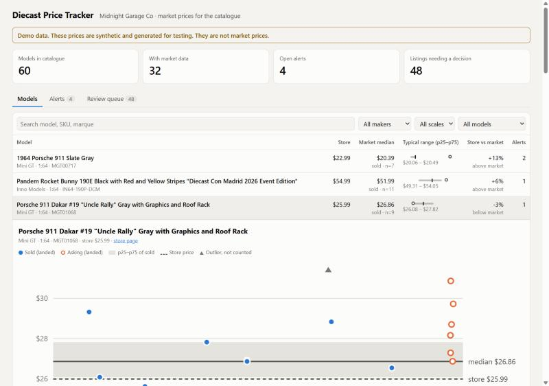

# diecast-tracker

A price tracker for the 1:64 and 1:18 diecast models that Midnight Garage Co. stocks or could stock. It answers one question before a restock: what does this model actually sell for? It also flags listings that come up well under the recent median.

Python 3.12 standard library only. No packages to install.



*The screenshot shows the demo database. Those prices are synthetic and the page labels them that way. They are not market prices.*

## Status

There are two ways to get data in.

- **CSV:** your own sales, buy costs, and sold comps noted by hand from Seller Hub Product Research. This works now. Start from [data/comps-template.csv](data/comps-template.csv).
- **eBay Browse API:** current asking prices, looked up live. The code is built to eBay's API terms and tested against a fake HTTP client. It has **not yet run against eBay**, because it needs the store owner's own Production keyset (see [eBay Browse](#ebay-browse)).

Everything after the source is shared: catalogue import, title matching, price history, stats, alerts and the dashboard.

## Quick start

```bash
python -m diecast_tracker demo
```

This builds `data/demo.db` with synthetic data and serves the dashboard on http://127.0.0.1:8064.

With real data:

```bash
python -m diecast_tracker ingest my-comps.csv
python -m diecast_tracker serve
```

Other commands:

| Command | What it does |
|---|---|
| `import-catalogue` | Rebuild `data/catalogue.json` from the store's public product pages |
| `match "<title>"` | Show how a listing title is matched, with reasons and runner-up candidates |
| `ingest FILE.csv [--source manual]` | Match, store and alert on a CSV of listings, sales or costs |
| `stats [SKU] [--days 90]` | Median and p25 to p75 per model |
| `alerts` | Open alerts |
| `purge` | Delete rows past their source's retention window |
| `ebay [SKU ...] [--in-stock]` | Look up current eBay asks for these models (default: the whole catalogue) |
| `serve [--port 8064]` | Dashboard, bound to 127.0.0.1 only |

`--db PATH` picks the database (default `data/tracker.db`).

### CSV format

Header row required. Only `title` and `price` are mandatory.

| column | meaning |
|---|---|
| `title` | listing title as written by the seller |
| `price` | item price |
| `shipping` | shipping charged (default 0). Stats use the **landed** price: item plus shipping |
| `kind` | `sold` (default), `ask` (still listed) or `cost` (what you paid or a dealer quote) |
| `currency` | default `USD`. Stats and alerts only use USD |
| `condition` | anything other than new makes the row non-comparable |
| `observed_at` | `2026-10-01` or ISO UTC. Defaults to now |
| `sku` | set this to skip matching, e.g. for your own invoice lines |
| `url`, `ref` | link, and a stable id so re-importing updates rather than duplicates |

## eBay Browse

`python -m diecast_tracker ebay` runs two searches per model: one by item number, one by maker plus casting name. The searches use category 222 (Diecast & Toy Vehicles), new condition, fixed-price or Best Offer, USD, and delivery to the US. Results go through the same matcher as everything else.

How it follows the terms in [docs/DATA_SOURCES.md](docs/DATA_SOURCES.md):

| eBay rule | What the tracker does |
|---|---|
| User Agreement: no scraping | Uses the Browse API only. Nothing fetches ebay.com pages. |
| API License s8.1: listing data at most 6 hours old; delete listings no longer available | eBay rows expire after 6 hours and are purged on every refresh and dashboard start. Each refresh deletes the asks it did not see again. |
| API License s9.5: no using eBay content to suggest or model prices | eBay asks never feed the reference median (`SourcePolicy.reference=False` in `db.py`). They show as **Live asks** and are checked against your own reference: your sales and comps, and your store price for the margin rule. |
| Default limit 5,000 calls per day | Capped at 1,000 calls per day, counted in the database. 60 models is 120 calls a refresh. |

Setup, all done by the store owner:

1. Create an eBay Developers Program account at developer.ebay.com and accept the API License Agreement.
2. Create a **Production** keyset.
3. On the Alerts & Notifications page, either opt out of Marketplace Account Deletion notifications ("Not persisting eBay data"), or subscribe an HTTPS endpoint. The Production keyset stays disabled until one is done. The tracker stores no eBay user data.
4. Put the keys in `.env` at the repo root. It is gitignored:

   ```
   EBAY_CLIENT_ID=...
   EBAY_CLIENT_SECRET=...
   # EBAY_ENV=sandbox   to try the sandbox first
   ```

Not yet checked against live responses:
- how well the generated search queries find each model;
- whether `shippingOptions` is always present in search results. When it is missing, the row is flagged `shipping_unknown` and alerts say so.

Whether using eBay asks for internal restock decisions sits within s9.5 is a judgement call. The tracker takes the conservative reading above. eBay Developer Support can confirm.

## How it works

```
source -> Listing -> matcher -> observations (SQLite) -> robust stats -> alert rules -> dashboard
```

### Catalogue

`data/catalogue.json` is read from midnightgarageco.com. The importer follows the sitemap to each `/product/` page and reads its schema.org `Product` JSON-LD. It checks `robots.txt` first and never calls `/api/`. Each entry holds the SKU, maker, scale, display name, marque, store price and stock state. The current file has the **60 models** the store lists.

### Matcher (`diecast_tracker/matcher.py`)

The matcher's job is to be right or refuse. A wrong match poisons a model's price history; a missed one only loses a data point. Every title gets one of four outcomes:

- **matched**: one model, confidently, and the listing is comparable.
- **rejected**: probably that model, but a lot, loose, chase, custom, damaged, 3D-printed, signed or box-only.
- **ambiguous**: two models fit about equally, e.g. the same DB5 casting in two Bond films. These go to the review queue.
- **no_match**: nothing fits, or the listing names another maker (Hot Wheels, Tomica, Matchbox and others).

Signals, strongest first:

1. **Item number**, in the spellings sellers use: `MGT00745`, `mgt 745`, `#745` with Mini GT named, `TL021-WH` for `T64G-TL021-WH`, `OT1173`, `GT507`, `64B0283`. A single item-number hit beats any fuzzy near-twin.
2. **Hard gates.** A stated scale, maker or marque that differs from the model's rules that model out.
3. **Rarity-weighted token overlap (IDF over the catalogue).** "Zonda" counts for much more than "RHD" or "Pandem". Before comparing, titles are normalised:
   - `RX-7` becomes `rx7`, and `GT-R` becomes `gtr`.
   - `LBWK`, `LB Works` and `LB-Super Silhouette` are folded to tokens that keep them distinct.
   - `Grey` becomes `gray`, and `Giallo` becomes `yellow`.
   - Adjacent words are glued so `RX 7` still finds `rx7`.
4. **Conflicts.** A stated colour, race number (`#31` vs `#311`) or steering side the model doesn't have means a sibling variant, not this model. A rare catalogue word belonging to another model ("Skyfall" vs "Thunderball") lowers the score.

Flag words that are part of the model's own name are ignored. The Skyfall DB5 is literally called "Damaged", so a listing saying so is not rejected. Words in a box-condition phrase ("box damaged, car mint") don't count against the car.

### Stats (`diecast_tracker/stats.py`)

Median and p10, p25, p75 and p90 (linear interpolation, matching numpy's default) are computed after outlier rejection:

- The main test is the modified z-score (Iglewicz and Hoaglin, |z| > 3.5, based on the MAD).
- When most prices are identical, the MAD is zero, so Tukey IQR fences take over.
- Below five points nothing is rejected.

An active listing seen on many polls counts once, at its latest price. Stats use a 90-day window. The dashboard compares the store price with the market only once there are at least five data points.

### Alerts (`diecast_tracker/alerts.py`)

- **below_median**: landed price at least 20% under the reference median. The reference is the sold median when there are at least five sales in 90 days, otherwise the asking median, never including the listing itself. A price under half the median still alerts, tagged *check seller and photos*.
- **restock_margin**: landed price leaves at least 35% of the store's own price as margin.

Alerts fire only on comparable, confidently matched (≥ 0.75) USD asks. Each fires once per listing. Thresholds live in `AlertRules`.

### Retention

Each source has a policy in `db.SOURCES`: how long its rows are kept, and whether its prices may build the reference median.

- `manual` rows are kept and count toward the reference.
- `ebay_browse` rows expire after 6 hours and never count.
- `demo_live` is the demo's synthetic stand-in for live asks. It is handled the same way and is not eBay data.

## Data sources

[docs/DATA_SOURCES.md](docs/DATA_SOURCES.md) records what was checked on 2026-10-26 and marks each item verified or unverified. In short:

- The **eBay Browse API** (free developer account) gives active listings only.
- **Sold data** through Marketplace Insights is limited release. The Finding API's `findCompletedItems` is decommissioned. Seller Hub's Product Research shows sold prices by hand only.
- eBay's **User Agreement prohibits scraping**.
- eBay's **API License Agreement** restricts using API data "to suggest or model prices". It also limits how long listing data may be kept.

Any developer account is the store owner's to create.

## Tests

```bash
python -m unittest
```

There are 40 tests:

- **Matcher:** 55 hand-written listing titles in sellers' styles (37 matched, 6 rejected, 3 ambiguous, 9 no-match), plus normalisation and flag unit tests.
- **Stats:** checked against numpy's percentile definition, plus outlier cases (fishing listings, starting bids, MSRP clusters, genuine wide spreads).
- **End to end:** de-duplication, shipping in the landed price, minimum samples, loose and lot exclusion, used condition, the suspicious tag, window cut-off, the restock rule, 6-hour retention, given SKUs and CSV import.
- **eBay source:** run against a fake HTTP client with hand-written responses. Covers the token flow and caching, request shape, the sandbox host, response parsing, credentials from `.env`, eBay asks kept out of the reference, alerts against your own sales, the unknown-shipping note, deleting ended listings, and the daily call cap.

## Layout

```
diecast_tracker/
  catalogue.py   store import (sitemap + JSON-LD) and the Model type
  normalize.py   scale, maker, marque, colour, race-number and token normalisation
  matcher.py     title -> model, or a reasoned refusal
  stats.py       percentiles, MAD/IQR outlier rejection
  db.py          SQLite schema, upserts, per-source retention
  alerts.py      alert rules
  tracker.py     ingest pipeline, overview, history, review queue, CSV reader
  server.py      localhost dashboard server
  static/        dashboard page (vanilla JS, inline SVG chart, light and dark)
  demo.py        synthetic demo data
  sources/
    ebay_browse.py eBay Browse API client and refresh
data/catalogue.json
data/comps-template.csv
docs/DATA_SOURCES.md
tests/
```

## Known limits

- The catalogue is what the store lists today: 60 models, no Minichamps or Spark yet. Maker aliases for both exist but have no catalogue entries to test against.
- Mini GT regional variants (for example `-MJ` Japan blister cards) are not modelled separately yet.
- A special or event edition listed without its edition name is held as ambiguous, because it may be the regular release.
